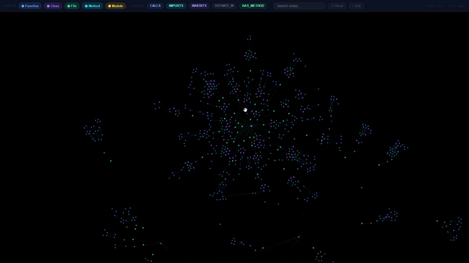
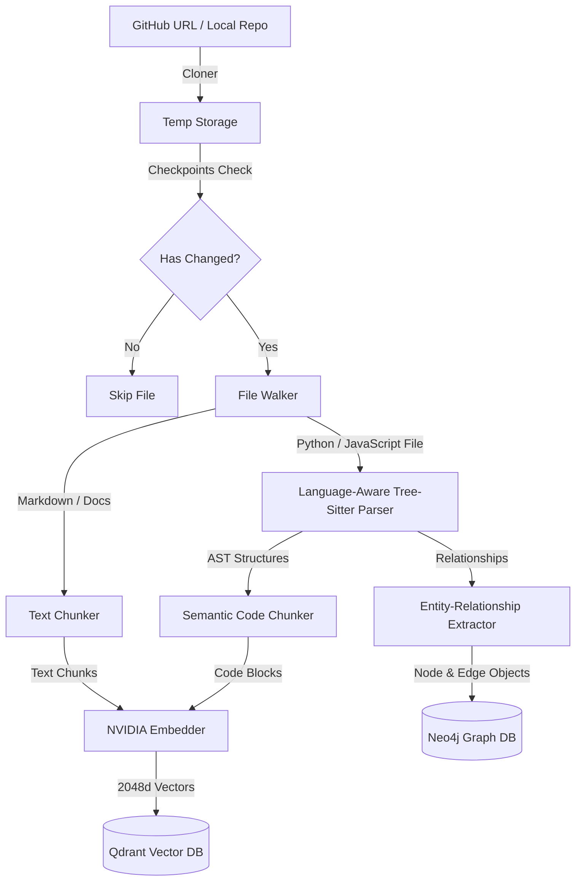
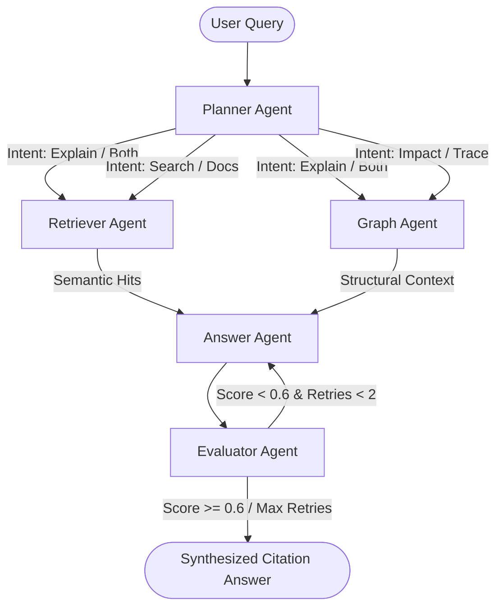
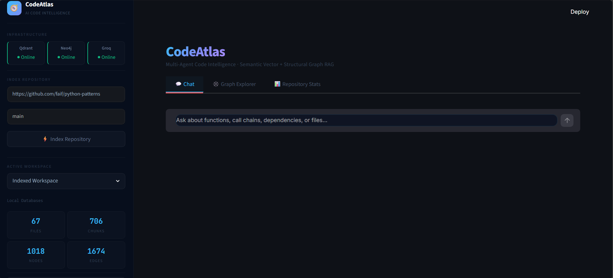
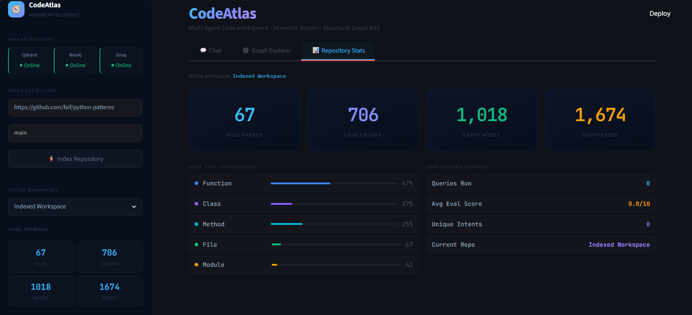
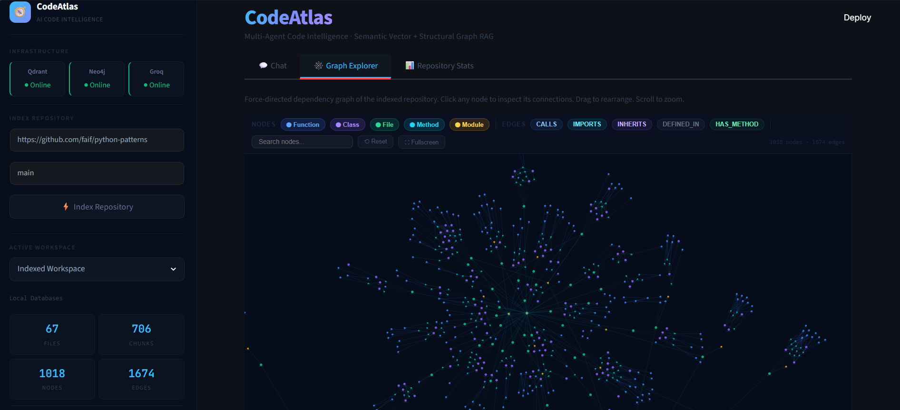

# CodeAtlas 🧭

An advanced, production-grade **Multi-Agent Code Intelligence System using Graph RAG**. CodeAtlas enables syntax-aware codebase ingestion, semantic and structural indexing, and self-correcting query execution over Python and JavaScript repositories.

Powered by **LangGraph**, **Neo4j**, **Qdrant**, **FastAPI**, **Streamlit**, and **Groq Llama-3.1**.



---

## 📖 Table of Contents
1. [Overview](#-overview)
2. [Key Features](#-key-features)
3. [System Architecture](#-system-architecture)
   - [1. Ingestion Pipeline](#1-ingestion-pipeline)
   - [2. Multi-Agent Query Pipeline](#2-multi-agent-query-pipeline)
4. [Technology Stack](#-technology-stack)
5. [Directory Structure](#-directory-structure)
6. [Prerequisites & Requirements](#-prerequisites--requirements)
7. [Installation & Setup](#-installation--setup)
8. [Running the Application](#-running-the-application)
9. [Running Tests](#-running-tests)
10. [Database Details](#-database-details)

---

## 🌟 Overview

CodeAtlas is a Multi-Agent Code Intelligence System that uses Graph RAG to understand Python and JavaScript codebases. It parses source structure with Tree-sitter and indexes it in Qdrant for semantic search and Neo4j for syntactic call and inheritance relationships. When you ask a question, a team of LangGraph agents analyzes your intent, retrieves semantic and structural context in parallel, and synthesizes a cited Markdown answer. An evaluator agent checks the response against retrieved context, and the Streamlit dashboard provides a force-directed D3.js visualization of code dependencies.

---

## ✨ Key Features

- **Syntax-Aware Code Ingestion**: Parses Python and JavaScript codebases using [Tree-sitter](https://tree-sitter.github.io/tree-sitter/) to extract classes, functions, methods, parameters, imports, variables, and syntactic relationships.
- **Dual-Database Indexing**:
  - **Qdrant**: Stores dense semantic embeddings (2048-dimensional vectors from `nvidia/nemotron-3-embed-1b`) of code blocks.
  - **Neo4j**: Captures structural code syntax, including inheritance (`INHERITS`), syntactic function calls (`CALLS`), definitions (`DEFINED_IN`), methods (`HAS_METHOD`), and imports (`IMPORTS`).
- **Parallel Retrieval**: Combines vector database semantic similarity search with Cypher-based graph traversals.
- **Multi-Agent Orchestration**: Coordinated with **LangGraph** to execute a resilient state machine workflow.
- **Self-Correcting Loop**: A dedicated Evaluator Agent grades synthesized answers; if grounding is insufficient (score < 0.6), the workflow automatically routes back to correction with actionable feedback.
- **Interactive Visualization UI**: A custom Streamlit-based web dashboard displaying real-time repository stats and rendering interactive force-directed code dependency graphs using D3.js.

---

## 🏗️ System Architecture

### 1. Ingestion Pipeline

The ingestion pipeline transforms raw source code files into vector embeddings and knowledge graph structures.



- **Cloning & Filtering**: [cloner.py](file:///c:/Users/Abhishek/Desktop/Code-Atlas/ingestion/cloner.py) clones repositories dynamically and walks files.
- **Incremental Indexing**: [checkpoint.py](file:///c:/Users/Abhishek/Desktop/Code-Atlas/ingestion/checkpoint.py) hashes code files and tracks status to support fast incremental updates.
- **AST Parsing**: [parser.py](file:///c:/Users/Abhishek/Desktop/Code-Atlas/ingestion/parser.py) reads Python and JavaScript source to detect components (Classes, Functions, Methods), imports, variables, and available inheritance information.
- **Semantic Code Chunking**: [chunker.py](file:///c:/Users/Abhishek/Desktop/Code-Atlas/ingestion/chunker.py) segments code using AST class and function block line boundaries, avoiding arbitrary text splitting.
- **Relation Extraction**: [extractor.py](file:///c:/Users/Abhishek/Desktop/Code-Atlas/ingestion/extractor.py) extracts syntactic connections (`IMPORTS`, `DEFINED_IN`, `HAS_METHOD`, `CALLS`, `INHERITS`). Call names are syntactic only and are not resolved to runtime targets.

---

### 2. Multi-Agent Query Pipeline

CodeAtlas uses a LangGraph state machine workflow to handle queries dynamically based on intent classification.



- **Planner Agent**: [planner.py](file:///c:/Users/Abhishek/Desktop/Code-Atlas/agents/planner.py) classifies the user's intent (`search`, `impact`, `trace`, `docs`, `explain`) and extracts Python code entities mentioned.
- **Retriever Agent**: [retriever.py](file:///c:/Users/Abhishek/Desktop/Code-Atlas/agents/retriever.py) executes vector searches in Qdrant using [semantic.py](file:///c:/Users/Abhishek/Desktop/Code-Atlas/retrieval/semantic.py).
- **Graph Agent**: [graph_agent.py](file:///c:/Users/Abhishek/Desktop/Code-Atlas/agents/graph_agent.py) runs Neo4j Cypher queries using [graph.py](file:///c:/Users/Abhishek/Desktop/Code-Atlas/retrieval/graph.py) to extract call hierarchies and inheritance models.
- **Answer Agent**: [answer.py](file:///c:/Users/Abhishek/Desktop/Code-Atlas/agents/answer.py) formats and merges data through [hybrid.py](file:///c:/Users/Abhishek/Desktop/Code-Atlas/retrieval/hybrid.py), prompting the LLM to write a cited Markdown answer.
- **Evaluator Agent**: [evaluator.py](file:///c:/Users/Abhishek/Desktop/Code-Atlas/agents/evaluator.py) checks the answer for hallucinations against the retrieved context. If flawed, it loops back to the Answer Agent.
- **State Flow**: [graph_flow.py](file:///c:/Users/Abhishek/Desktop/Code-Atlas/agents/graph_flow.py) implements the LangGraph workflow structure.

---

## 🖥️ User Interface & Interactive Demos

### 📊 Repository Dashboard & Stats
The Streamlit dashboard allows you to ingest any public GitHub repository, tracks parsing statistics, and manages local checkpoints.

| Ingestion Dashboard | Repository Statistics |
| :---: | :---: |
|  |  |

---

### 🕸️ Interactive D3.js Code Graph
Explore call graphs, definitions, and class inheritances interactively. Hover over nodes to highlight code connections, and inspect elements to see underlying source structures.

| Graph Explorer | Dynamic Force Graph |
| :---: | :---: |
|  |  |

---

### 💬 Multi-Agent Chat & Self-Correction
Watch CodeAtlas answer complex code queries in real-time, executing hybrid search and evaluating answers with corrective feedback:

<video src="assets/chat_demo.mp4" controls width="100%"></video>

---

## 🛠️ Technology Stack

| Layer | Component / Package | Purpose |
| :--- | :--- | :--- |
| **AST Parsing** | `tree-sitter`, `tree-sitter-python`, `tree-sitter-javascript` | Python and JavaScript structure extraction |
| **Vector Database** | `qdrant-client` | Semantic code snippet similarity indexing |
| **Graph Database** | `neo4j` | Call graph & hierarchy traversal |
| **Embeddings** | `openai` (Compatible API client) | NVIDIA `nemotron-3-embed-1b` embedding generator (2048 dimensions) |
| **LLMs & Agents** | `groq`, `langgraph`, `langchain-core` | Agent reasoning, workflow orchestration |
| **API Backend** | `fastapi`, `uvicorn`, `pydantic` | Backend REST services |
| **Frontend UI** | `streamlit` | User dashboard & interactive D3.js visualization |
| **Utilities** | `gitpython`, `python-dotenv` | Git repository cloning and configuration |
| **Testing** | `pytest` | Unit & integration testing |

---

## 📂 Directory Structure

```text
Code-Atlas/
├── agents/                  # Multi-agent orchestrators and nodes
│   ├── answer.py            # Answer Synthesis Agent
│   ├── evaluator.py         # Grounding & Correctness Evaluation Agent
│   ├── graph_agent.py       # Graph Retrieval Agent
│   ├── graph_flow.py        # LangGraph Workflow Construction
│   ├── planner.py           # Intent Classification & Entity Extraction Agent
│   └── retriever.py         # Semantic Vector Retrieval Agent
├── api/                     # FastAPI Backend Server
│   ├── routes/
│   │   ├── ingest.py        # Repository ingestion & checkpoint endpoints
│   │   └── query.py         # Agent query & repository visualization endpoints
│   ├── main.py              # Backend Application Entrypoint
│   └── models.py            # Pydantic Request/Response Models
├── data/                    # Local storage for databases and repo checkpoints
│   ├── neo4j_data/          # Neo4j volume mount
│   ├── qdrant_storage/      # Qdrant volume mount
│   └── temp_repos/          # Cloned repositories directory (gitignored)
├── ingestion/               # Code parser and indexer pipeline
│   ├── checkpoint.py        # Incremental indexing tracker
│   ├── chunker.py           # Syntax-aware & text chunkers
│   ├── cloner.py            # Git repository cloner & file walker
│   ├── extractor.py         # Entity & relationship extractor (Tree-sitter AST)
│   └── parser.py            # Code AST parser (Tree-sitter Python and JavaScript)
├── retrieval/               # Query retrievers
│   ├── graph.py             # Neo4j Cypher query interfaces
│   ├── hybrid.py            # Semantic and Graph context merger & formatter
│   └── semantic.py          # Qdrant vector retrieval interface
├── storage/                 # Database managers and embedder
│   ├── embedder.py          # NVIDIA embedding API client
│   ├── graph_store.py       # Neo4j database driver connector
│   └── vector_store.py      # Qdrant database driver connector
├── tests/                   # Integration and Mock Tests
│   ├── run_tests.py         # CLI test suite entry point
│   ├── test_agents.py       # Agent component and state machine mock tests
│   ├── test_checkpoint.py   # Checkpointing logic unit tests
│   ├── test_parser.py       # Tree-sitter AST parsing integration tests
│   ├── test_javascript_ingestion.py # JavaScript ingestion and storage mocks
│   └── test_retrieval.py    # Mock database retrieval tests
├── docker-compose.yml       # Qdrant and Neo4j database service configuration
├── requirements.txt         # Project Dependencies
└── .env                     # Local Environment configuration (API Keys & Ports)
```

---

## 📋 Prerequisites & Requirements

- **Python**: `3.10` or `3.11`
- **Docker & Docker Compose**: Installed and running (for database containers)
- **API Keys**:
  - **GROQ API Key**: For agent LLM execution (Llama-3.1-8b-instant). Get a key from [Groq Console](https://console.groq.com/).
  - **NVIDIA API Key**: For code embeddings (`nvidia/nemotron-3-embed-1b`). Get a key at [NVIDIA Build](https://build.nvidia.com/).

---

## ⚙️ Installation & Setup

### 1. Clone the Code-Atlas Repository
```bash
git clone https://github.com/Abhishek-Raj0/CODEATLAS.git
cd Code-Atlas
```

### 2. Configure Environment Variables
Create a file named `.env` in the root directory (copy from existing configuration or use the template below):
```ini
# LLM Keys
GROQ_API_KEY=your_groq_api_key_here

# NVIDIA Embedding API
NVIDIA_API_KEY=your_nvidia_api_key_here
NVIDIA_EMBED_MODEL=nvidia/nemotron-3-embed-1b

# Neo4j Configuration
NEO4J_URI=bolt://127.0.0.1:7687
NEO4J_USER=neo4j
NEO4J_PASSWORD=password123

# Qdrant Configuration
QDRANT_HOST=127.0.0.1
QDRANT_PORT=6333
QDRANT_COLLECTION=codeatlas_code
```

### 3. Start Database Containers
Launch Neo4j and Qdrant database instances locally using Docker:
```bash
docker-compose up -d
```
Verify they are running:
- **Qdrant dashboard**: [http://localhost:6333/dashboard](http://localhost:6333/dashboard)
- **Neo4j browser**: [http://localhost:7474](http://localhost:7474) (Login with user `neo4j` and password `password123` or your customized credentials)

### 4. Create and Activate Virtual Environment
```bash
python -m venv atlas_venv

# On Windows (PowerShell):
.\atlas_venv\Scripts\Activate.ps1

# On macOS/Linux:
source atlas_venv/bin/activate
```

### 5. Install Dependencies
```bash
pip install --upgrade pip
pip install -r requirements.txt
```

---

## 🚀 Running the Application

### 1. Start the FastAPI Backend Server
Run the FastAPI web server using Uvicorn:
```bash
uvicorn api.main:app --host 127.0.0.1 --port 8000 --reload
```
Access the interactive OpenAPI Swagger documentation at: [http://127.0.0.1:8000/docs](http://127.0.0.1:8000/docs).

### 2. Start the Streamlit Frontend Web App
In a new terminal window (with the virtual environment activated), launch the Streamlit frontend:
```bash
streamlit run ui/app.py
```
Streamlit will automatically open the dashboard in your default browser at: [http://localhost:8501](http://localhost:8501).

---

## 🧪 Running Tests

A comprehensive suite of mock and integration tests is available under the `tests` directory.

To run the ingestion and JavaScript support tests:
```bash
pytest -q tests/test_parser.py tests/test_javascript_ingestion.py
```

The legacy mock-suite runner is also available:
```bash
python tests/run_tests.py
```

This script will run:
1. **Phase 4 Agent Mock Tests**: Validates the agent nodes and compiler flow without calling live LLMs.
2. **Phase 2 Storage Mock Tests**: Validates vector and graph store managers.
3. **Phase 1 Ingestion Integration Tests**: Runs the Tree-sitter code parser, syntax chunker, and entity extractor on temporary directories.

---

## 📊 Database Details

### Ingesting a JavaScript repository

Start the API as described above, then submit a public GitHub repository through the existing ingestion endpoint. In PowerShell:
```powershell
$job = Invoke-RestMethod -Uri "http://127.0.0.1:8000/api/ingest" -Method Post -ContentType "application/json" -Body (@{ github_url = "https://github.com/OWNER/REPOSITORY"; branch = "main" } | ConvertTo-Json)
$jobId = $job.job_id
do {
    Start-Sleep -Seconds 2
    $status = Invoke-RestMethod -Uri "http://127.0.0.1:8000/api/ingest/$jobId"
} while ($status.status -in @("pending", "running"))
$status
```
The file walker includes `.py`, `.js`, `.jsx`, `.mjs`, `.cjs`, `.md`, `.txt`, and `.rst` files while excluding ignored dependency and generated directories.

### Qdrant Vector Collection
- **Collection Name**: `codeatlas_code`
- **Vector Size**: 2048 (Cosine distance similarity)
- **Payload Metadata**:
  - `name`: Element name (function/class name)
  - `file_path`: Source file relative path
  - `entity_type`: Entity type classification (`class`, `function`, `method`, `documentation`, `generic`)
  - `start_line` / `end_line`: File line bounds for contextual code extraction

### Neo4j Graph Model
CodeAtlas builds a syntactic network in Neo4j:
- **Nodes**:
  - `File`: Represents a source or documentation file.
  - `Class`: Represents a Python or JavaScript class declaration.
  - `Function`: Represents a module-level function or variable-bound JavaScript function.
  - `Method`: Represents a class-scoped function.
- **Relationships**:
  - `DEFINED_IN`: Connects a `Class`, `Function`, or `Method` to its containing `File`.
  - `HAS_METHOD`: Connects a `Class` to its `Method` nodes.
  - `INHERITS`: Connects a child `Class` node to its parent `Class` node.
  - `CALLS`: Connects a caller to a syntactically observed call name; names are not resolved to runtime targets.
  - `IMPORTS`: Connects a `File` node to imported namespaces.
